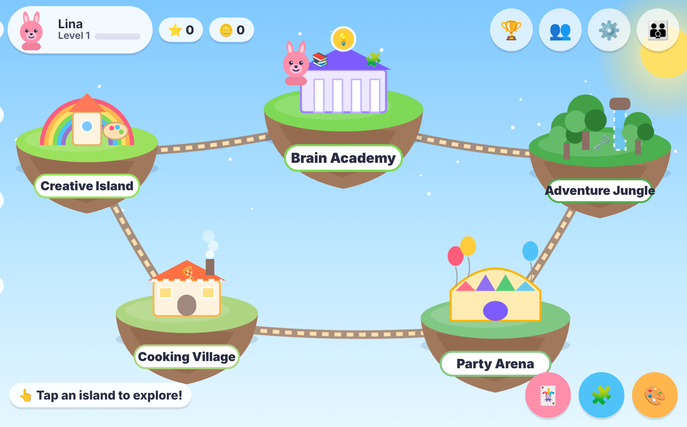
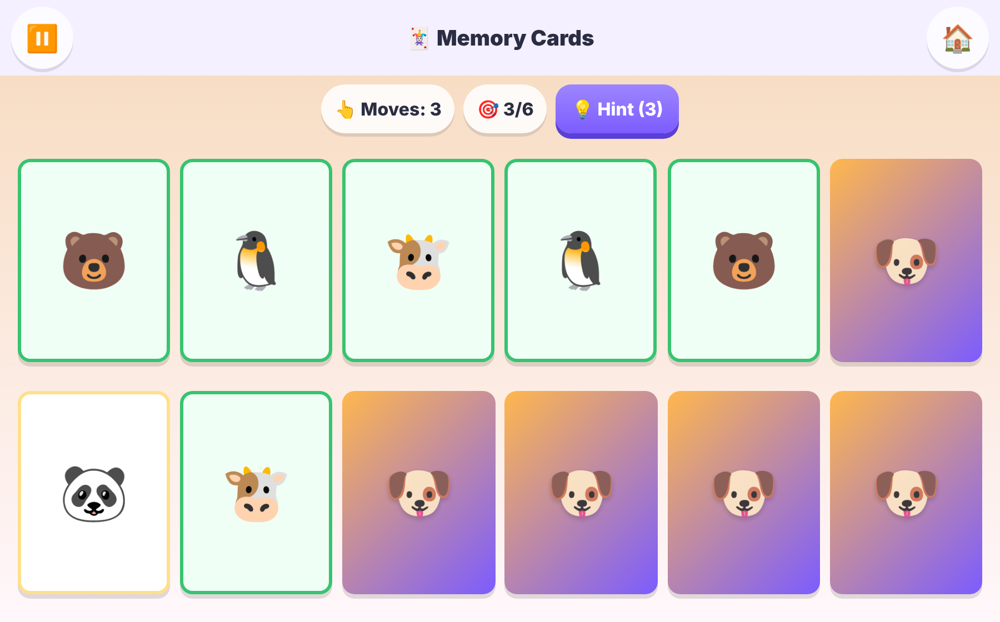
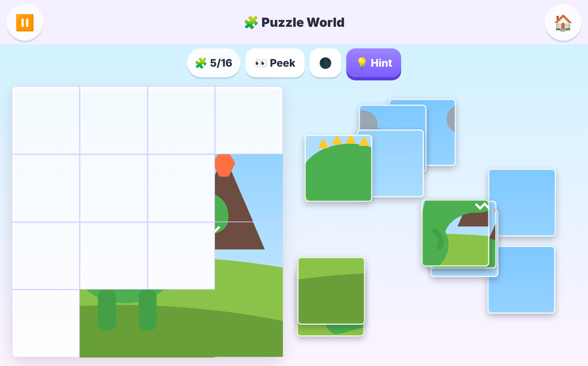
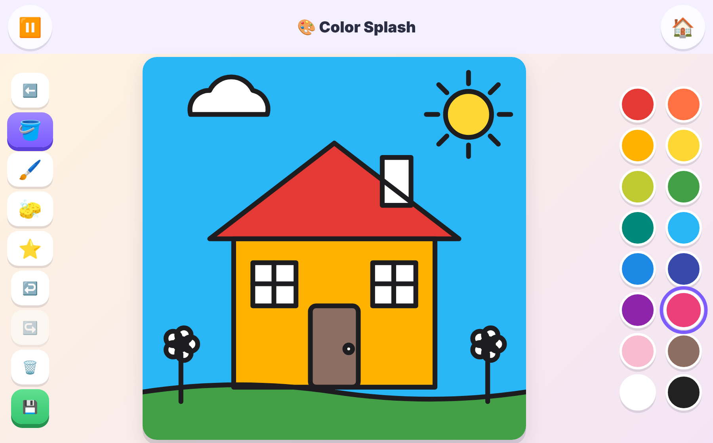
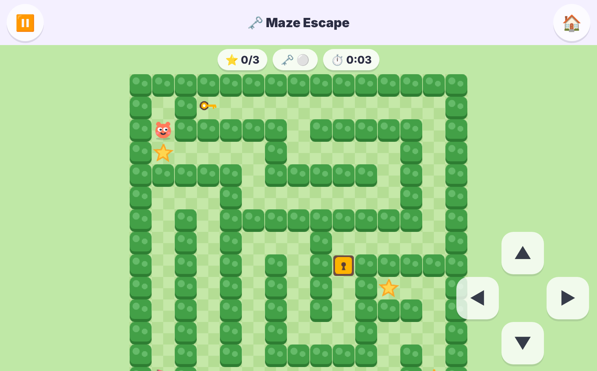
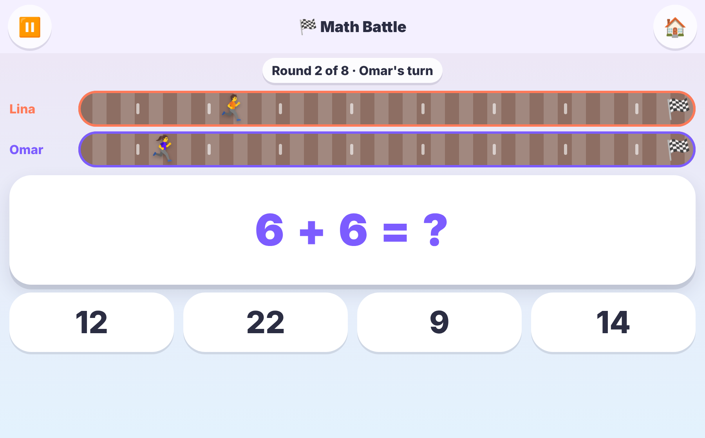
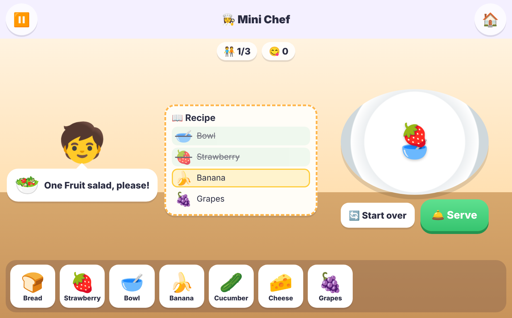

# KidsPlay 🎈

An offline game world for kids aged 4–12, with six games, child profiles, stars and rewards, Arabic and English, and a parents area. There are no ads, no accounts and no tracking, and every game runs without internet.

**Built with:** React, TypeScript, Vite, Phaser 3, Capacitor (Android and iOS), and IndexedDB for local saves.



---

## The games

### 🃏 Memory Cards
Flip two cards at a time to find matching pairs. Choose from 4 difficulty levels (6–30 cards) and 6 themes. It has hints, an optional timer, and a two-player mode.



### 🧩 Puzzle World
Drag the pieces onto the board and they snap into place. Puzzles have 4–36 pieces, with 12 pictures across 6 themes. You can peek at the full picture or ask for a hint.



### 🎨 Color Splash
Tap a shape to fill it, or draw freely with the brush. There are 17 pictures, plus stickers, an eraser, undo/redo, and a gallery for saved drawings.



### 🗝️ Maze Escape
Reach the flag. Collect stars and pick up keys to open doors. There are 20 levels, and you move with the arrow buttons, by swiping, or with the keyboard.



### 🏁 Math Battle
Answer math questions to move your runner to the finish. Questions suit the child's age, from counting up to fractions. There's a two-player race mode.



### 👩‍🍳 Mini Chef
Read the customer's order, then add the ingredients in the right order and serve the dish. There are 6 recipes and 12 levels, and new recipes unlock as you play.



---

## Run it locally

```bash
cd kidsplay
npm install
npm run dev        # open http://localhost:5173
npm test           # unit tests
```

## Deploy as a website

```bash
npm run build      # output goes to dist/
```

Upload the `dist/` folder to any static host, such as Netlify, Vercel, GitHub Pages, Firebase Hosting or S3. After the first visit the site keeps working offline.

## Build the Android app

Run all commands from inside the `kidsplay/` folder.

You need Android Studio (which includes the Android SDK) and JDK 21.

```bash
npm run build
npx cap sync android
npx cap open android          # opens Android Studio
```

- **Test APK:** in Android Studio choose *Build → Build APK(s)*, or run `cd android && ./gradlew assembleDebug`. The file is `android/app/build/outputs/apk/debug/app-debug.apk`.
- **Google Play release:** first create `android/keystore.properties` (see [RELEASE.md](kidsplay/RELEASE.md)), then run `./gradlew bundleRelease`. The file is `app-release.aab`.

## Build the iOS app

You need a Mac with Xcode and an Apple Developer account.

```bash
npm run build
npx cap sync ios
npx cap open ios              # opens Xcode
```

In Xcode, pick your Team under **Signing & Capabilities**, then choose **Product → Archive → Distribute App** to upload to the App Store.

> After any code change, run `npm run build && npx cap sync` again before building the app.

---

## More docs

- [RELEASE.md](kidsplay/RELEASE.md): signing and store checklists
- [ARCHITECTURE.md](kidsplay/ARCHITECTURE.md): how the code is organized
- [docs/CONTENT_PACKS.md](kidsplay/docs/CONTENT_PACKS.md): adding downloadable levels
- [docs/ADDING_A_GAME.md](kidsplay/docs/ADDING_A_GAME.md): adding a new game
- [PRIVACY_AND_SAFETY.md](kidsplay/PRIVACY_AND_SAFETY.md): child safety and privacy

To refresh the screenshots, run `npm run build && npm run preview -- --port 4173` in one terminal and `node scripts/take-screenshots.mjs` in another.

---

## باختصار (عربي)

- **التشغيل:** `npm install` ثم `npm run dev`
- **ملاحظة:** نفّذ كل الأوامر من داخل مجلد `kidsplay/`
- **نشر كموقع:** `npm run build` ثم ارفع مجلد `dist/` على أي استضافة
- **تطبيق أندرويد:** `npm run build && npx cap sync android && npx cap open android` ثم من Android Studio اختر Build APK
- **تطبيق آيفون:** على جهاز Mac: `npm run build && npx cap sync ios && npx cap open ios` ثم من Xcode اختر Archive
- **الألعاب:** بطاقات الذاكرة، عالم الألغاز، رشّة ألوان، الهروب من المتاهة، سباق الرياضيات، الطاهي الصغير
